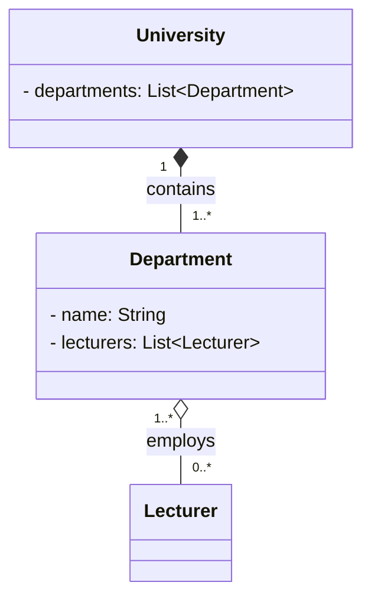
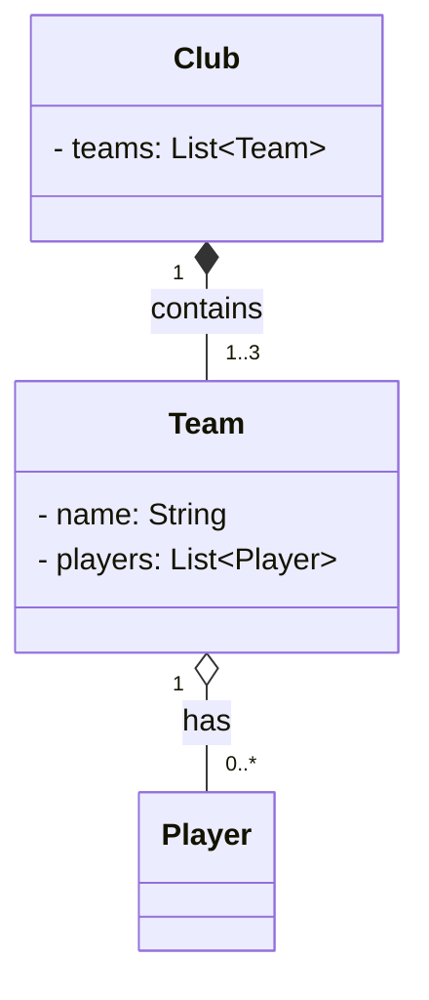
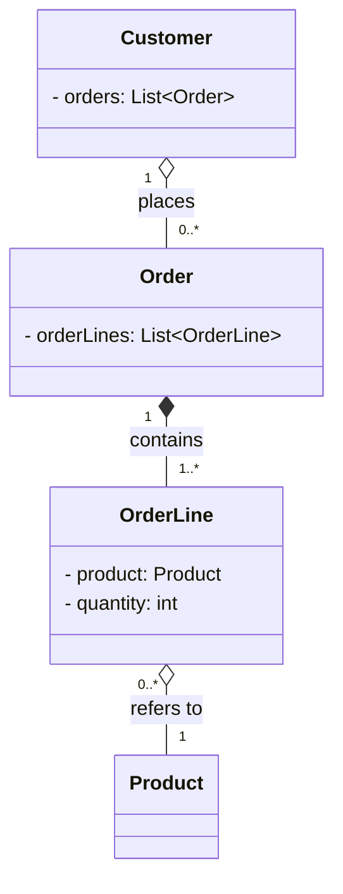

# Exercises OOP_2

## Exercise 1: Bank Accounts
- added a withdraw method, because the balance is private and cannot be accessed directly from outside the class. The withdraw method allows for controlled access to the balance, ensuring that it can only be modified through defined operations.  
- "new Account" wouldn't work because Account is an abstract class. By specifying the account-type, the code knows automatically which "processMonth()" method to call, as each subclass implements its own version of the method. This is an example of polymorphism, where the same method name can have different behaviors depending on the object type.

## Exercise 2: University Departments

### Relationships

| Pair | Relationship | Why |
|------|-------------|-----|
| `University` → `Department` | **Composition** (filled diamond ◆) | Departments cannot exist without their university. If the university closes, all departments cease to exist with it. The university owns and controls their lifecycle. |
| `Department` → `Lecturer` | **Aggregation** (hollow diamond ◇) | Lecturers exist independently of any single department. They survive if a department is dissolved and can be reassigned. A lecturer can also belong to more than one department at the same time. |

### Class Diagram

### Arrow types

- `*--` **Composition**: filled diamond on the owning side (`University`).  
  The child (`Department`) cannot exist without the parent; destroyed together.

- `o--` **Aggregation**: hollow diamond on the containing side (`Department`).  
  The contained object (`Lecturer`) has an independent lifecycle and can be shared across multiple containers.

### Multiplicity

| Association | University end | Department end |
|-------------|---------------|----------------|
| University ↔ Department | `1`: a department belongs to exactly one university | `1..*`: a university has at least one department |

| Association | Department end | Lecturer end |
|-------------|---------------|--------------|
| Department ↔ Lecturer | `1..*`: a lecturer teaches in at least one department | `0..*`: a department may have zero or more lecturers |

## Exercise 3: Sports Club

### Relationships

| Pair | Relationship | Why |
|------|-------------|-----|
| `Club` → `Team` | **Composition** (filled diamond ◆) | Teams cannot exist without their club. If the club is dissolved, all teams cease to exist with it. The club owns and controls their lifecycle. |
| `Team` → `Player` | **Aggregation** (hollow diamond ◇) | Players exist independently of any single team. They survive if a team is dissolved and can be reassigned. A player can be transferred to another club or loaned to a different team. If the team is disbanded, the player still exists. |

### Class Diagram

### Arrow types

- `*--` **Composition**: filled diamond on the owning side (`Club`).  
  The child (`Team`) cannot exist without the parent; destroyed together.

- `o--` **Aggregation**: hollow diamond on the containing side (`Team`).  
  The contained object (`Player`) has an independent lifecycle and can be shared across multiple containers.

### Multiplicity

| Association | Club end | Team end |
|-------------|---------|----------|
| Club ↔ Team | `1`: a team belongs to exactly one club | `1..3`: a club has at least one team |

| Association | Team end | Player end |
|-------------|---------|------------|
| Team ↔ Player | `1`: a player belongs to exactly one team at a time | `0..*`: a team may have zero or more players |

## Exercise 4: Customer Orders

### Relationships

| Pair | Relationship | Why |
|------|-------------|-----|
| `Order` → `OrderLine` | **Composition** (filled diamond ◆) | OrderLines cannot exist without their Order. If the Order is canceled, all OrderLines are also removed. The Order owns and controls their lifecycle. |
| `OrderLine` → `Product` | **Aggregation** (hollow diamond ◇) | Products exist independently of any single OrderLine. They survive if an OrderLine is removed, and the same Product can appear in many OrderLines across many Orders. |
| `Customer` → `Order` | **Aggregation** (hollow diamond ◇) | Orders have value independent of the Customer object's lifecycle — they're typically kept as business/legal records even after a customer account is deleted. Unlike OrderLines, an Order doesn't become meaningless without its Customer. |

### Class Diagram

### Arrow types

- `*--` **Composition**: filled diamond on the owning side (`Order`).  
  The child (`OrderLine`) cannot exist without the parent; destroyed together.

- `o--` **Aggregation**: hollow diamond on the containing side (`Customer` and `OrderLine`).  
  The contained objects (`Order` and `Product`) have an independent lifecycle and can be shared across multiple containers.
  

### Multiplicity
| Association | Customer end | Order end |
|-------------|---------|----------|
| Customer ↔ Order | `1`: an order belongs to exactly one customer | `0..*`: a customer may have zero or more orders |

| Association | Order end | OrderLine end |
|-------------|---------|------------|
| Order ↔ OrderLine | `1`: an order line belongs to exactly one order | `1..*`: an order must have at least one order line |

| Association | OrderLine end | Product end |
|-------------|---------|------------|
| OrderLine ↔ Product | `0..*`: a product may appear in zero or more order lines | `1`: an order line refers to exactly one product |

