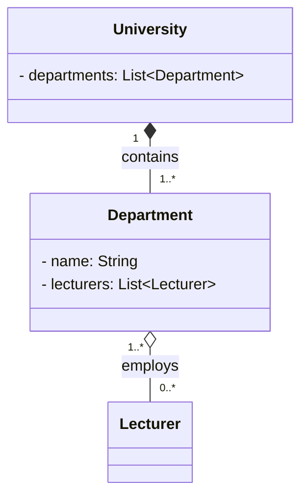

# Exercises OOP_2

## Exercise 1: Bank Accounts
- added a withdraw method, because the balance is private and cannot be accessed directly from outside the class. The withdraw method allows for controlled access to the balance, ensuring that it can only be modified through defined operations.  
- "new Account" wouldn't work because Account is an abstract class. By specifying the account-type, the code knows automatically which "processMonth()" method to call, as each subclass implements its own version of the method. This is an example of polymorphism, where the same method name can have different behaviors depending on the object type.

## Exercise 2: University Departments

### Relationships

| Pair | Relationship | Why |
|------|-------------|-----|
| `University` → `Department` | **Composition** (filled diamond ◆) | Departments cannot exist without their university. If the university closes, all departments cease to exist with it. The university owns and controls their lifecycle. |
| `Department` → `Lecturer` | **Aggregation** (hollow diamond ◇) | Lecturers exist independently of any single department. They survive if a department is dissolved and can be reassigned. A lecturer can also belong to more than one department at the same time. |

### Class Diagram

### Arrow types

- `*--` **Composition**: filled diamond on the owning side (`University`).  
  The child (`Department`) cannot exist without the parent; destroyed together.

- `o--` **Aggregation**: hollow diamond on the containing side (`Department`).  
  The contained object (`Lecturer`) has an independent lifecycle and can be shared across multiple containers.

### Multiplicity

| Association | University end | Department end |
|-------------|---------------|----------------|
| University ↔ Department | `1`: a department belongs to exactly one university | `1..*`: a university has at least one department |

| Association | Department end | Lecturer end |
|-------------|---------------|--------------|
| Department ↔ Lecturer | `1..*`: a lecturer teaches in at least one department | `0..*`: a department may have zero or more lecturers |
